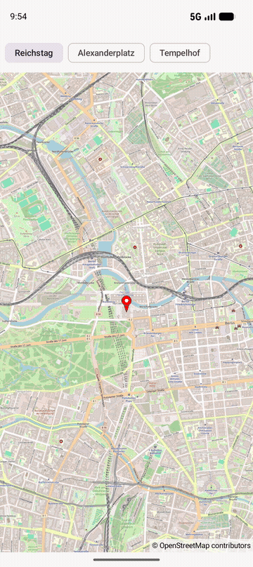

ComposeMap
==========

Kotlin / Jetpack Compose app with a reusable `OpenStreetMap()` composable, which wraps [OpenMapView](https://github.com/afarber/OpenMapView) and moves the camera when the selected place changes.

Answer to the Stack Overflow question [Create a map using openstreetmap with jetpack compose in Kotlin](https://stackoverflow.com/q/77297775).

