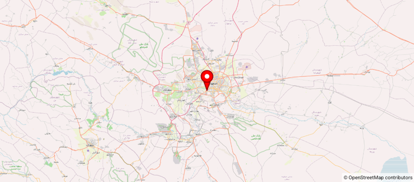

ComposeOnlyMap
==============

Kotlin / Jetpack Compose app showing [OpenMapView](https://github.com/afarber/OpenMapView) without any XML layout or User-Agent setup.

Answer to the Stack Overflow question [Using osmdroid in a jetpack compose project](https://stackoverflow.com/q/77890423).

