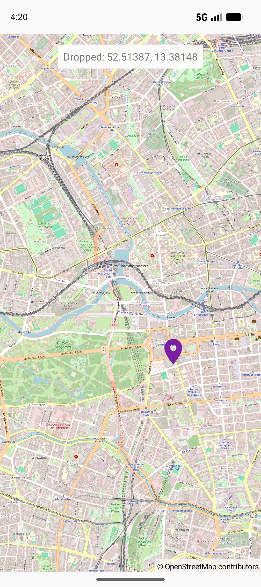

DraggableMarker
===============

Kotlin app using [OpenMapView](https://github.com/afarber/OpenMapView) to show a draggable marker with a custom icon and display its position while dragging.

Answer to the Stack Overflow question [Marker in osmdroid map](https://stackoverflow.com/q/79250427).

