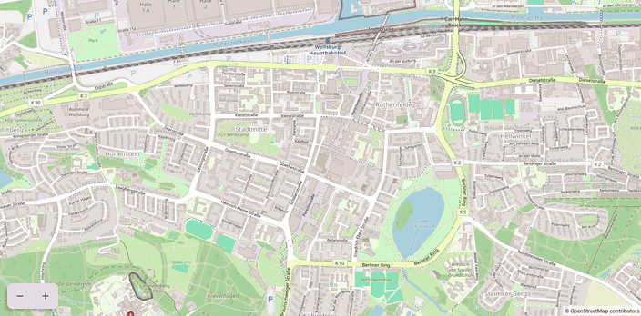

# DrivingRoute

Android Automotive route planner using Compose, OpenMapView, and the public OSRM backend to route between two tapped locations.

## Details

Tap the map to place a green start marker and then a red destination marker. The ViewModel requests an OSRM driving route, displays its polyline and route information, and fits the camera to the result. Cancel clears the route and markers; failed requests are reported through the UI.

Map rendering uses [OpenMapView](https://github.com/afarber/OpenMapView).

## Build and run

The Android application is the `automotive` module. It compiles against SDK 37, targets API 35, and requires API 34 or newer. Current dependency versions are in [gradle/libs.versions.toml](gradle/libs.versions.toml).

From this directory:

```sh
./gradlew :automotive:assembleDebug
./gradlew :automotive:installDebug
```

Route requests use `https://router.project-osrm.org/route/v1/driving/` and need network access. Ktor handles JSON responses and request timeouts; StateFlow exposes route and error state to the Compose UI.

## Screenshot


