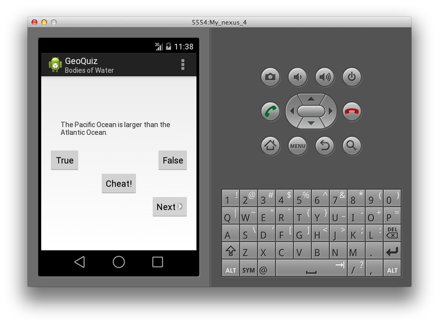

# GeoQuiz

True-or-false geography quiz with next-question navigation and a separate answer-reveal screen.

## Details

The quiz checks answers and shows feedback. CheatActivity can reveal the current answer, and the quiz tracks that result to change its response when the user returns.

This is a legacy Eclipse/ADT project. Its declared SDK and library references are in [project.properties](project.properties).

## Screenshot

