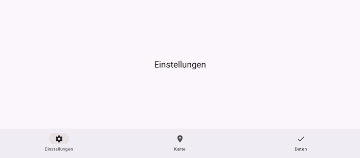

# MapInTabs

Compose navigation-tab example preserving a map's camera when switching to another tab and back.

## Details

One NavigationBar destination hosts OpenMapView. The camera state survives destination changes, so returning to the map keeps the position selected before leaving it.

Map rendering uses [OpenMapView](https://github.com/afarber/OpenMapView).

Answer to the Stack Overflow question [osmdroid map disappears after switchings tabs](https://stackoverflow.com/q/77384062).

## Screenshot

