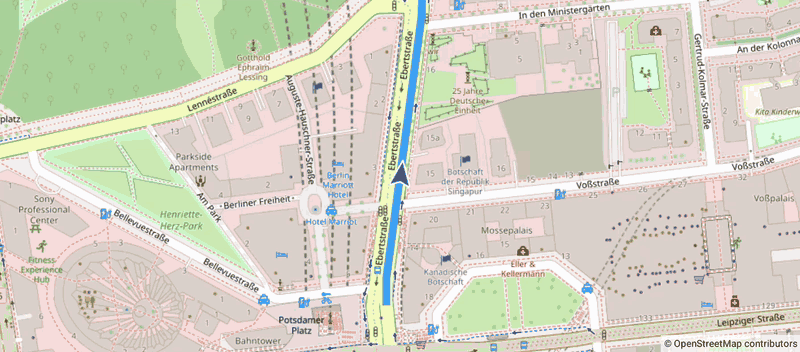

MovingMarker
============

Kotlin / Jetpack Compose app with [OpenMapView](https://github.com/afarber/OpenMapView), which moves a navigation arrow smoothly along a car route and keeps the map centered on it. One animation sets the marker position, its rotation and the camera in the same frame, so the map and the marker stay in sync.

Answer to the Stack Overflow question [Osmdroid how to move position marker in animative way with animateTo function](https://stackoverflow.com/q/74200873).

