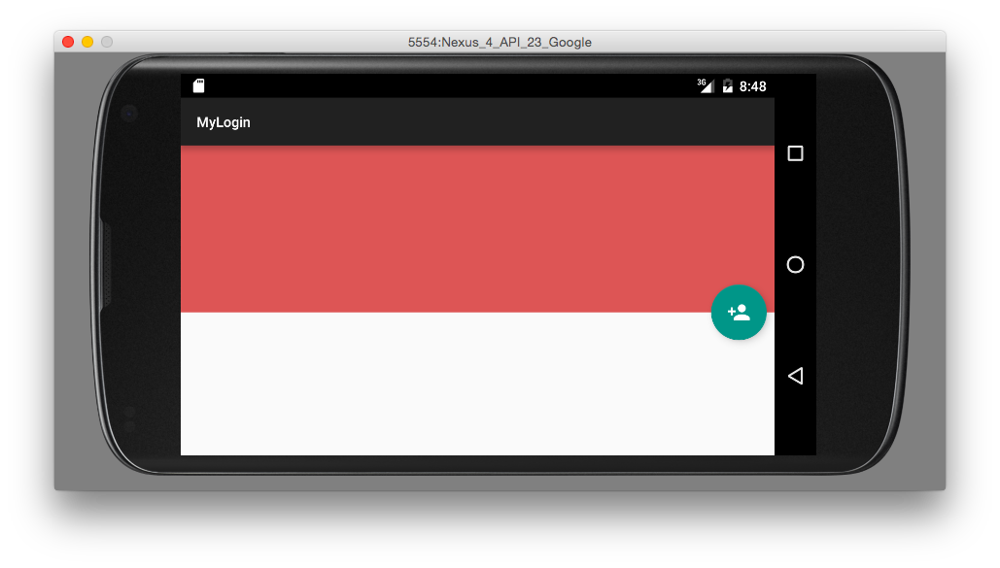

# MyLogin

Fragment-based social-login experiment with provider screens and an animated login button.

## Details

The app separates account selection from provider-specific fragments, including Google, Facebook, and Twitter screens. It uses legacy provider SDKs and app registrations rather than a standalone authentication backend.

## Screenshot

