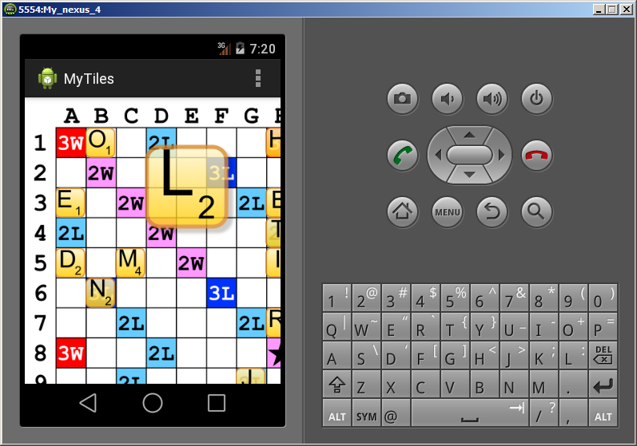

# MyTiles

Custom word board with draggable letter tiles, grid snapping, and corner masks that respond to neighboring tiles.

## Details

The view places tiles in a 15-by-15 grid and redraws their corners when adjacency changes. Letter and score text are drawn over tile artwork, with a larger preview used during dragging.

## Build and run

Requires JDK 17 or newer and Android SDK 37. The app supports Android 6.0 (API 23) and newer, and targets API 35. Dependencies are pinned in [gradle/libs.versions.toml](gradle/libs.versions.toml).

From this directory:

```sh
./gradlew :app:assembleDebug :app:lintDebug
./gradlew :app:installDebug
```

## Screenshot

Original emulator screenshot, preserved.


