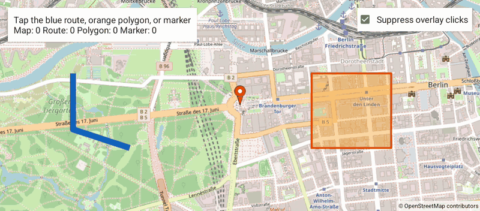

NoOverlayClick
==============

Java / XML app with MIT-licensed [OpenMapView](https://github.com/afarber/OpenMapView) 0.29.1, comparing normal and suppressed overlay interactions.

- With **Suppress overlay clicks** checked, the blue route and orange polygon have `clickable(false)`. Taps on them reach the map listener. The marker listener returns `true`, consuming its click without opening an info window or moving the camera.
- With suppression off, the shapes are clickable and their callbacks update the status. The marker listener returns `false`, allowing its normal info window and camera behavior. Shapes have no automatic popup.
- Turning suppression on closes an open marker window. Geometry, camera position, and callback counters are preserved. Panning and zoom gestures remain enabled.

The route is illustrative geometry, not a calculated road route. The example does not import KML.

```java
Polyline route = map.addPolyline(new PolylineOptions().addAll(points).clickable(false));
Polygon area = map.addPolygon(new PolygonOptions().addAll(vertices).clickable(false));
map.setOnMarkerClickListener(marker -> true);
```

For existing shapes, call `route.setClickable(false)` and `area.setClickable(false)`.

Answer to the Stack Overflow question [Disable onClick event on Osmdroid's overlays](https://stackoverflow.com/q/43332459).



Build and install with `./gradlew :app:installDebug`. The dependency is `implementation("de.afarber:openmapview:0.29.1")`.

With the 1408x792 automotive emulator running, run `./record-gif.sh` to tap the route, polygon, and marker in both modes, then restore suppression. It uses `~/src/OpenMapView/scripts/capture-gif.sh` unchanged, with crop `1408:620:0:76` to remove the system bars.
