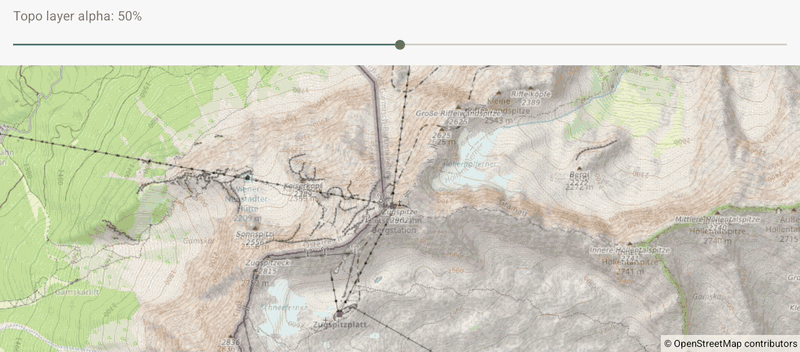

# OverlayAlpha

Java map example adjusting the transparency of a topographic tile overlay.

## Details

The overlay is drawn above the base map, and its alpha changes independently. This demonstrates blending a second tile layer with the map underneath it.

Map rendering uses [OpenMapView](https://github.com/afarber/OpenMapView).

Answer to the Stack Overflow question [OSMDroid: how do I set a fixed layer alpha?](https://stackoverflow.com/q/77871221).

## Recording

Build and install the debug app, then run `./record-gif.sh` from this directory
with `Automotive_1408p_landscape` (1408×792) running. Requires ADB and FFmpeg;
set `ANDROID_SERIAL` if the emulator is not `emulator-5554`.
The script waits for tile loading, then changes overlay alpha from 50% to 0%,
100%, and back to 50%. The shared recorder crops the system bars and produces
an 800 px wide `screenshot.gif` below 4 MB.

## Screenshot

