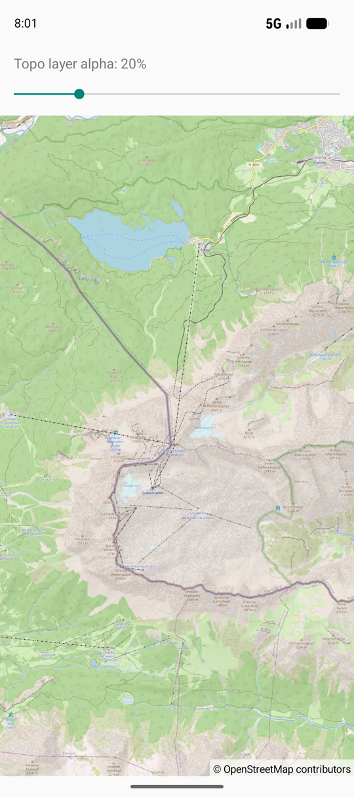

OverlayAlpha
============

Java app using [OpenMapView](https://github.com/afarber/OpenMapView) to draw an OpenTopoMap layer over the OpenStreetMap base map and change its alpha with a SeekBar.

Answer to the Stack Overflow question [OSMDroid: how do I set a fixed layer alpha?](https://stackoverflow.com/q/77871221).

