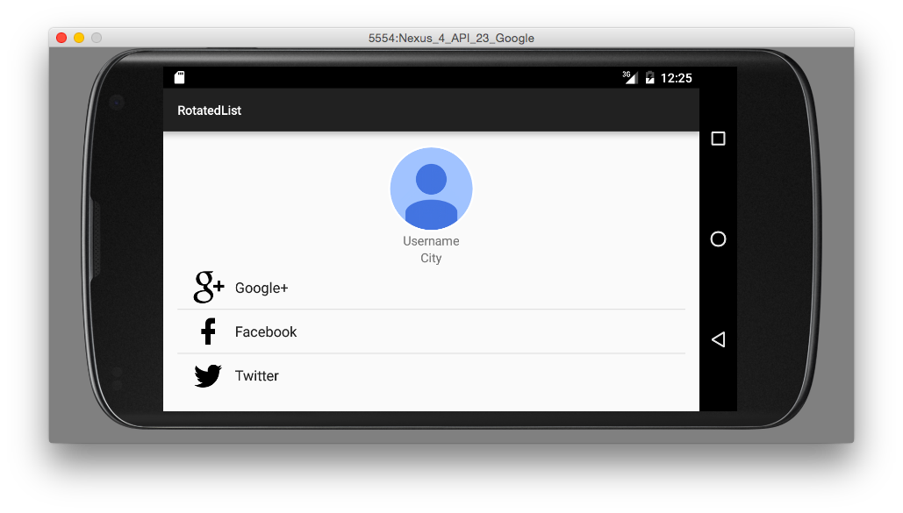

# RotatedList

Fragment-navigation example opening an account-provider list with a circular profile image and click feedback.

## Details

The main fragment's account button opens a ListFragment after a short delay. Provider rows use icons and checked-list styling, and a tap shows the selected provider's name.

## Build and run

Requires JDK 17 or newer and Android SDK 37. The minimum Android version is 6.0 (API 23); the app targets API 35. Dependencies are pinned in `gradle/libs.versions.toml`.

From this directory:

```sh
./gradlew :app:assembleDebug :app:lintDebug :app:testDebugUnitTest :app:assembleDebugAndroidTest
./gradlew :app:installDebug
```

## Screenshot


