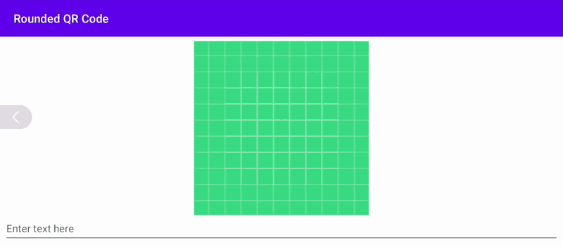

# RoundedQRCode

A rounded QR code generated from text using drawing code adapted from Telegram.

## Build and run

Requires JDK 17 or newer and Android SDK 37. The minimum Android version is 6.0 (API 23); the app targets API 35. Dependencies are pinned in `gradle/libs.versions.toml`.

From this directory:

```sh
./gradlew :app:assembleDebug :app:lintDebug :app:testDebugUnitTest :app:assembleDebugAndroidTest
./gradlew :app:installDebug
```

## Recording

After installing the app on `Automotive_1408p_landscape` (1408×792):

```sh
./record-gif.sh
```

Set `ANDROID_SERIAL` to select the emulator and `OPENMAPVIEW_DIR` if the OpenMapView checkout is elsewhere. The script uses its `scripts/capture-gif.sh` helper and FFmpeg, crops the system bars, and keeps `screenshot.gif` below 4 MiB. The original PNG is retained.

See the [Telegram project](https://github.com/DrKLO/Telegram) for the original rounded QR drawing code.


