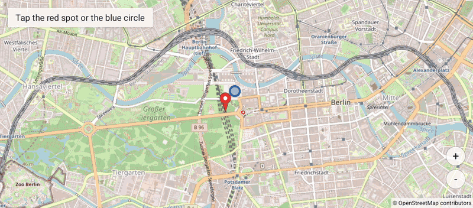

# ScalingMarker

Java map example showing a clickable ground overlay and circle whose sizes are specified in meters.

## Details

The red spot and blue circle grow or shrink on screen as the camera zoom changes. Their geographic size stays fixed, illustrating the difference between meter-sized overlays and ordinary marker icons.

Map rendering uses [OpenMapView](https://github.com/afarber/OpenMapView).

Answer to the Stack Overflow question [Custom Marker in OpenStreetMap](https://stackoverflow.com/q/76817554).

## Screenshot

