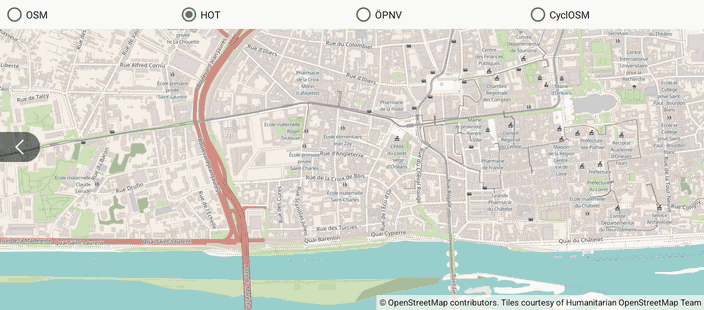

SimpleMapStyle
==============

Kotlin app using [OpenMapView](https://github.com/afarber/OpenMapView) to switch between the standard OpenStreetMap tiles and other map styles, which need no API key.

Answer to the Stack Overflow question [I can't display map tiles other than MAPNIK with osmdroid, I want a simplier map](https://stackoverflow.com/q/78547714).

