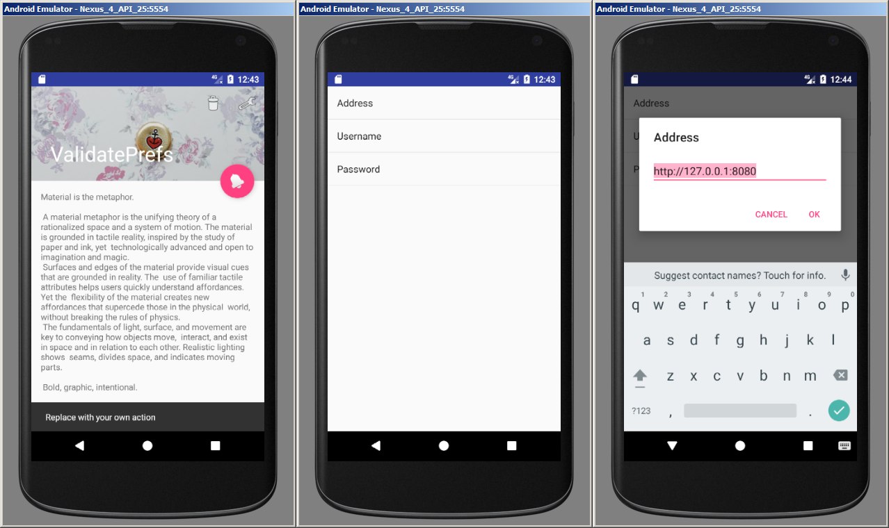

# ValidatePrefs

Preference-validation example checking an address, username, and password before saving changes.

## Details

A PreferenceActivity validates proposed EditTextPreference values. Empty values are rejected, the address is parsed as a URI, and usernames and passwords must contain more than four characters.

## Build and run

Requires JDK 17 or newer and Android SDK 37. The minimum Android version is 6.0 (API 23); the app targets API 35. Dependencies are pinned in `gradle/libs.versions.toml`.

From this directory:

```sh
./gradlew :app:assembleDebug :app:lintDebug :app:testDebugUnitTest :app:assembleDebugAndroidTest
./gradlew :app:installDebug
```

## Screenshot


