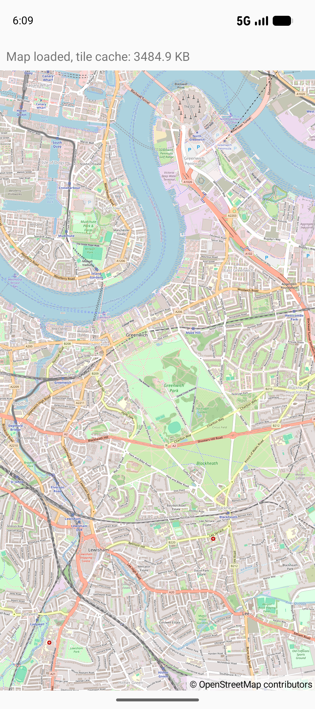

ZeroSetupMap
============

Kotlin app using [OpenMapView](https://github.com/afarber/OpenMapView) to show map tiles without any storage permission or cache configuration, also after clearing the app storage.

Answer to the Stack Overflow question [How do I get OSMDroid sample code to show map tiles after clearing the app storage?](https://stackoverflow.com/q/78873489).

